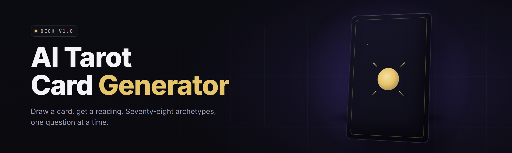

  
  
  

  

  
  

---

`tarot-ai-card-forge` is a Windows desktop app that turns a short prompt into a complete, printable tarot deck. It generates card art, writes the card meanings, builds spreads, and renders a press-ready PDF — all offline after the first model download.

| Term | Explanation |
| --- | --- |
| **Deck** | A set of 78 cards: 22 Major Arcana + 56 Minor Arcana (Wands, Cups, Swords, Pentacles). |
| **Arcana** | The two divisions of a tarot deck. Major = archetypes. Minor = everyday life suits. |
| **Spread** | A layout of cards with positions and meanings (e.g. Celtic Cross, Three-Card). |
| **Upright / Reversed** | A card read as-drawn vs rotated 180°. Each has its own meaning block. |
| **Style Preset** | A locked art direction — line weight, palette, background texture — applied to every card. |
| **Prompt Seed** | The short text you type that drives the art generator. Reused for consistency. |
| **Export Target** | The output format: PDF (print), PNG (digital), or JSON (foundry/tabletop). |

- One prompt → a visually consistent deck, not 78 mismatched renders.
- Full meaning text generated per card, upright and reversed.
- Print-ready PDFs at 300 DPI with bleed and crop marks.
- CSV/JSON export for tabletop, journaling, or app import.
- Works offline after the model bundle downloads once.

---

## 📥 Download

  

---

## 📋 Compatibility

| Platform | Status | Notes |
| --- | --- | --- |
| Windows 11 (x64) | ✅ Supported | Primary target. |
| Windows 10 22H2 (x64) | ✅ Supported | Requires VC++ 2015–2022 redistributable. |
| Windows 10 (ARM) | ⚠️ Limited | Runs under emulation; slower renders. |
| Windows 8.1 | ❌ Not supported | Missing GPU runtime features. |
| macOS / Linux | ❌ Not supported | No native build at this time. |
| Offline mode | ✅ Supported | After initial model bundle download. |
| GPU (NVIDIA) | ✅ Recommended | CUDA path for faster card art. |
| CPU-only | ✅ Supported | Slower; usable for small decks. |

---

## 🧩 Module Catalog

### 🎨 Art Generation Modules

1. **Prompt Composer** — assembles the base prompt from style preset + card name + suit context.
2. **Seed Locker** — pins a seed so every card in a deck shares line weight and palette.
3. **Palette Enforcer** — restricts the sampler to a locked color range per deck.
4. **Texture Layer** — adds paper grain, gilding, or matte finish overlays.
5. **Border Renderer** — draws the frame, suit pip, and corner index ornaments.
6. **Reversal Variant** — auto-generates the rotated-art variant used on reversed cards.

### 📖 Meaning & Text Modules

7. **Meaning Writer** — generates upright and reversed meanings per card.
8. **Keyword Extractor** — pulls 3–5 keywords per card for quick reference.
9. **Elemental Mapper** — tags each card with element, planet, and zodiac association.
10. **Spread Narrator** — writes the positional meaning for each spread slot.
11. **Tone Selector** — sets the voice: classic, modern, Jungian, or secular.
12. **Glossary Builder** — compiles a deck glossary from generated keywords.

### 🗂️ Deck Assembly Modules

13. **Deck Composer** — assembles 78 cards into a consistent, ordered deck.
14. **Major Arcana Set** — the 22 archetype cards with dedicated art rules.
15. **Minor Suit Set** — Wands, Cups, Swords, Pentacles with suit-specific art.
16. **Court Card Set** — Page, Knight, Queen, King with rank-appropriate styling.
17. **Duplicate Guard** — detects near-identical renders and re-rolls them.
18. **Ordering Engine** — enforces canonical deck order or custom ordering.

### 🖨️ Export & Print Modules

19. **PDF Renderer** — 300 DPI print sheets with bleed and crop marks.
20. **PNG Exporter** — per-card PNGs for digital decks and journals.
21. **JSON Exporter** — structured deck data for tabletop apps.
22. **CSV Exporter** — flat card list with meanings and keywords.
23. **Sheet Layouter** — packs cards into print sheets (A4, Letter, Tabloid).
24. **Back Design** — generates a matching card back from the same preset.

### 🔮 Spread & Reading Modules

25. **Spread Library** — built-in spreads: Three-Card, Celtic Cross, Horseshoe, and more.
26. **Custom Spread Builder** — draw your own spread with named positions.
27. **Reading Simulator** — draws a random hand and reads it against the deck.
28. **Journal Mode** — save readings with timestamps and notes.
29. **Reversal Probability** — set the chance a drawn card reads reversed.

### ⚙️ Engine & Utility Modules

30. **Model Manager** — downloads, verifies, and swaps art model bundles.
31. **VRAM Guard** — steps down batch size when GPU memory runs low.
32. **Batch Scheduler** — queues 78 renders and resumes after a crash.
33. **Cache Store** — caches renders so re-exports skip the generator.
34. **Style Preset Editor** — build and save your own art presets.
35. **Import Preset** — load a preset from a shared preset file.
36. **Log Viewer** — shows render logs and errors inline.
37. **Theme Pack** — color themes for the app UI itself.
38. **Hotkey Map** — remappable shortcuts for deck and export actions.
39. **Auto-Updater** — checks for app updates on launch.
40. **Integrity Check** — validates deck files before export.
41. **Crash Reporter** — local crash dumps, never auto-sent.

---

## 💻 System Requirements

| Component | Minimum | Recommended |
| --- | --- | --- |
| OS | Windows 10 22H2 (x64) | Windows 11 (x64) |
| CPU | 4-core x64 | 8-core x64 |
| RAM | 8 GB | 16 GB |
| GPU | DX12-capable, 4 GB VRAM | NVIDIA RTX, 8 GB+ VRAM |
| Disk | 6 GB free | 20 GB free SSD |
| Runtime | VC++ 2015–2022 redistributable | Same |
| Display | 1280×720 | 1920×1080 |
| Network | Required for model bundle download | Same |

---

## 🧭 Overview

| Category | Details |
| --- | --- |
| Type | Windows desktop app (.exe) |
| Purpose | Generate complete, printable AI tarot decks |
| Engine | Local art model with CUDA + CPU fallback |
| Output | PDF, PNG, JSON, CSV |
| Modes | Deck generation, reading, journaling |
| Data | All local; no account required |
| Updates | In-app updater, manual opt-out |

The app is built for readers, artists, and tabletop creators who want a deck that looks like one deck — not a folder of mismatched images. Everything is generated locally after the model bundle is fetched once, so decks stay private.

---

## 🩹 The Problem

- Generic AI image tools produce 78 cards that look like 78 different decks.
- No tool writes the meaning text alongside the art.
- Print files come out at screen resolution, not 300 DPI with bleed.
- Reversed-card art is usually skipped entirely.
- Suits and court cards drift in style from the Major Arcana.
- Manual assembly of a deck takes hours and still looks inconsistent.
- Export formats for tabletop apps are an afterthought.

---

## 🛠️ The Solution

| Problem | Solution |
| --- | --- |
| Mismatched cards | Seed Locker + Palette Enforcer lock style across all 78. |
| No meaning text | Meaning Writer generates upright + reversed text per card. |
| Low-res prints | PDF Renderer outputs 300 DPI with bleed and crop marks. |
| Missing reversed art | Reversal Variant auto-generates rotated art variants. |
| Suit style drift | Minor Suit Set applies suit-locked art rules. |
| Hours of assembly | Deck Composer builds the full 78 in one run. |
| Weak exports | JSON, CSV, and PNG exporters ship with the deck. |

---

## 🎯 Key Features

| Feature | Description | Benefit |
| --- | --- | --- |
| Prompt Composer | Builds the base prompt from preset + card context. | One input, full deck. |
| Seed Locker | Pins a seed across the whole deck. | Consistent art, no re-rolls. |
| Reversal Variant | Generates rotated-art variants automatically. | Reversed cards look intentional. |
| Meaning Writer | Writes upright + reversed meanings. | No separate writing pass. |
| Spread Library | Ships Celtic Cross, Three-Card, and more. | Read immediately. |
| PDF Renderer | 300 DPI print sheets with crop marks. | Print-shop ready. |
| JSON Exporter | Structured deck data. | Drops into tabletop apps. |
| Custom Spread Builder | Name your own positions. | Personalize readings. |
| Journal Mode | Save readings with notes. | Track your practice. |
| Style Preset Editor | Build your own presets. | Own the look. |
| Cache Store | Skips re-renders on export. | Fast re-exports. |
| Integrity Check | Validates decks before export. | No broken files. |

---

## 📚 Table of Contents

- [What is tarot-ai-card-forge](#-what-is-tarot-ai-card-forge)
- 

  

(#-download)
- [Compatibility](#-compatibility)
- [Module Catalog](#-module-catalog)
- [System Requirements](#-system-requirements)
- [Overview](#-overview)
- [The Problem](#-the-problem)
- [The Solution](#-the-solution)
- [Key Features](#-key-features)
- [Usage Guidelines](#-usage-guidelines)
- [All Modules Status](#-all-modules-status)
- [Installation](#-installation)
- [Known Issues](#-known-issues)
- [FAQ](#-faq)

---

## ✅ Usage Guidelines

| Allowed | Not allowed |
| --- | --- |
| Generate decks for personal use. | Reselling decks as your own art. |
| Print decks for your own study. | Claiming AI art as hand-painted. |
| Use decks in tabletop sessions. | Redistributing the model bundles. |
| Share presets you built. | Bundling the app into paid products. |
| Export JSON for your own apps. | Removing license and credit files. |
| Modify the app for yourself. | Republishing it under a new name. |

---

## 📊 All Modules Status

| Module | Status | Description |
| --- | --- | --- |
| Prompt Composer | ✅ Working | Base prompt assembly. |
| Seed Locker | ✅ Working | Deck-wide seed pinning. |
| Palette Enforcer | ✅ Working | Locked per-deck palette. |
| Texture Layer | ✅ Working | Grain, gilding, matte overlays. |
| Border Renderer | ✅ Working | Frame, pips, corner ornaments. |
| Reversal Variant | ✅ Working | Rotated-art variants. |
| Meaning Writer | ✅ Working | Upright + reversed text. |
| Keyword Extractor | ✅ Working | 3–5 keywords per card. |
| Elemental Mapper | ✅ Working | Element, planet, zodiac tags. |
| Spread Narrator | ✅ Working | Positional meaning text. |
| Tone Selector | ✅ Working | classic/modern/jungian/secular. |
| Glossary Builder | ✅ Working | Deck glossary from keywords. |
| Deck Composer | ✅ Working | Full 78-card assembly. |
| Major Arcana Set | ✅ Working | 22 archetype cards. |
| Minor Suit Set | ✅ Working | Wands/Cups/Swords/Pentacles. |
| Court Card Set | ✅ Working | Page/Knight/Queen/King. |
| Duplicate Guard | ✅ Working | Re-rolls near-duplicates. |
| Ordering Engine | ✅ Working | Canonical or custom order. |
| PDF Renderer | ✅ Working | 300 DPI print sheets. |
| PNG Exporter | ✅ Working | Per-card PNGs. |
| JSON Exporter | ✅ Working | Structured deck data. |
| CSV Exporter | ✅ Working | Flat card list. |
| Sheet Layouter | ✅ Working | A4/Letter/Tabloid packing. |
| Back Design | ✅ Working | Matching card back. |
| Spread Library | ✅ Working | Celtic Cross, Three-Card, more. |
| Custom Spread Builder | ✅ Working | Named spread positions. |
| Reading Simulator | ✅ Working | Random hand + read. |
| Journal Mode | ✅ Working | Saved readings + notes. |
| Reversal Probability | ✅ Working | Adjustable reversed chance. |
| Model Manager | ✅ Working | Bundle download + verify. |
| VRAM Guard | ✅ Working | Batch step-down on low VRAM. |
| Batch Scheduler | ✅ Working | Queued 78-card renders. |
| Cache Store | ✅ Working | Skips re-renders on export. |
| Style Preset Editor | ✅ Working | Build your own presets. |
| Import Preset | ✅ Working | Load shared preset files. |
| Log Viewer | ✅ Working | Inline render logs. |
| Theme Pack | ✅ Working | App UI color themes. |
| Hotkey Map | ✅ Working | Remappable shortcuts. |
| Auto-Updater | ✅ Working | Update check on launch. |
| Integrity Check | ✅ Working | Deck validation before export. |
| Crash Reporter | ✅ Working | Local crash dumps only. |

---

## ⌨️ Hotkeys

| Action | Default |
| --- | --- |
| Generate deck | Ctrl+G |
| Export PDF | Ctrl+P |
| Export JSON | Ctrl+J |
| Next card | → |
| Previous card | ← |
| Draw reading | Ctrl+R |
| Save reading | Ctrl+S |
| Open presets | Ctrl+Shift+P |

---

## 🧱 Installation

1. Visit the project page and download the latest Windows build.
2. Extract the archive to a folder you own (avoid Program Files).
3. Run the `.exe`. On first launch the app downloads the model bundle.
4. Wait for the integrity check to pass, then start generating.

---

## 🐞 Known Issues

| Issue | Solution |
| --- | --- |
| Render hangs on low VRAM | Lower batch size in Settings → Engine. |
| PDF font fallback on some locales | Install the bundled font pack. |
| CUDA not detected | Update to the latest NVIDIA driver. |
| Slow first render | Model is loading into cache; subsequent runs are faster. |
| JSON import fails in some apps | Use the CSV exporter instead. |

---

## ❔ FAQ

1. **Do I need an internet connection?**
   Only for the initial model bundle download. After that everything runs offline.

2. **Can I print the deck at a print shop?**
   Yes. The PDF Renderer outputs 300 DPI sheets with bleed and crop marks.

3. **Does the app set the reversal art automatically?**
   Yes. Reversal Variant generates the rotated-art variant for every card.

4. **Can I use my own art preset?**
   Yes. Style Preset Editor lets you build and save custom presets.

5. **Where are my decks saved?**
   In the folder you set under Settings → Output. Defaults to Documents.

6. **Are readings saved?**
   Yes, if Journal Mode is on. Each reading is timestamped with notes.

7. **Do I need admin rights?**
   No, as long as you extract to a folder you own.

8. **Can I export for tabletop apps?**
   Yes. JSON and CSV exporters cover most tabletop formats.

9. **Does the app phone home?**
   No. The updater checks for app updates only, and you can disable it.

10. **Is the deck licensed for resale?**
    No. Decks are for personal and tabletop use only.

---

The app is built for people who want a deck that reads as one object — one palette, one line weight, one voice — without hours of manual assembly. Everything runs locally once the model bundle lands, and every export is print-aware by default. If you're building a deck for study, tabletop, or a personal project, this is the tool that keeps all 78 cards pulling in the same direction.

  

